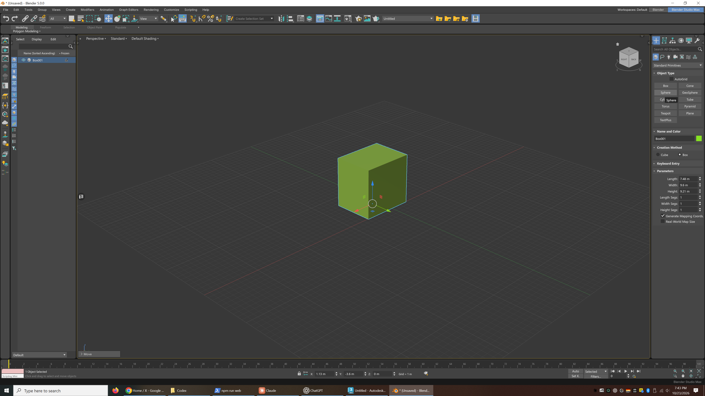
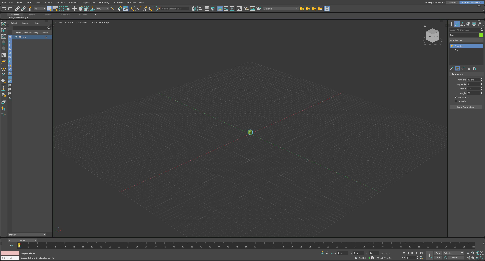
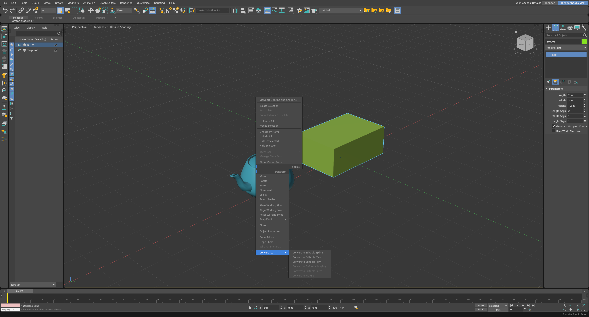
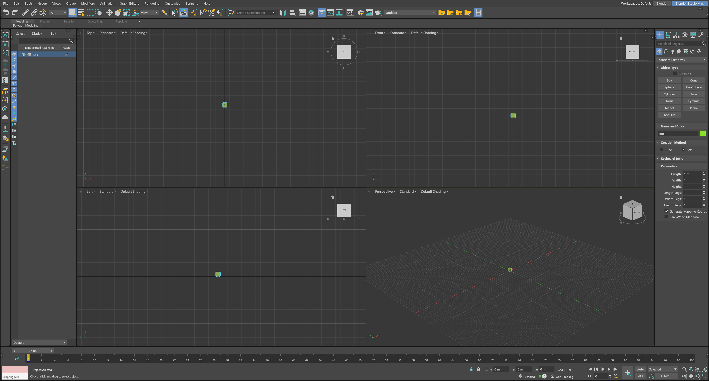
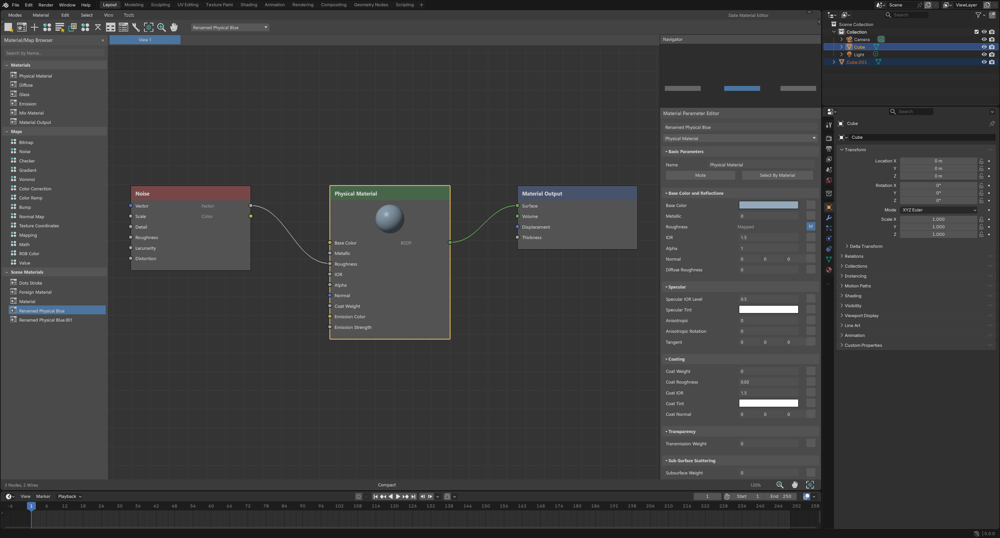
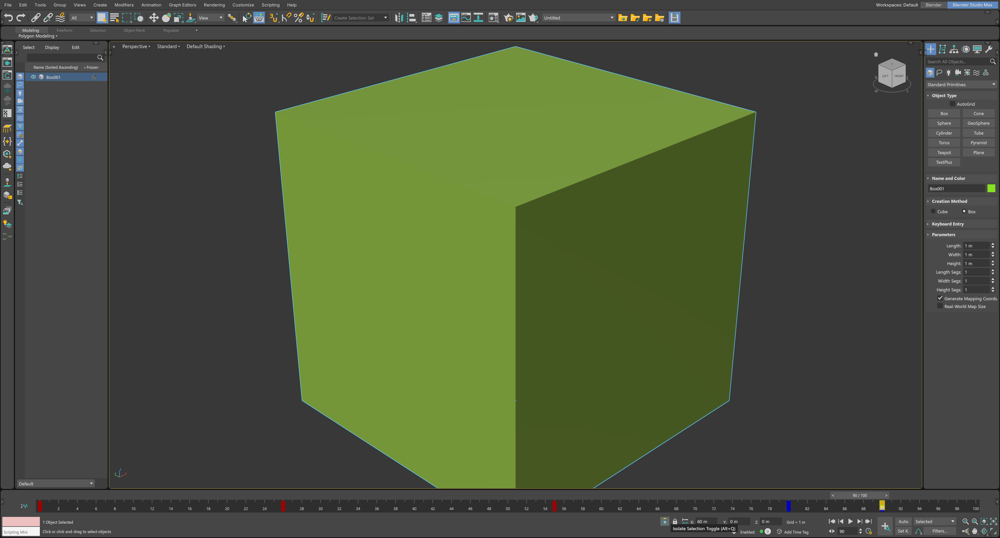

<h1 align="center">Blender Max</h1>
<h3 align="center">For Max users, in Blender.</h3>

A familiar interface. Blender’s tools and possibilities.

<strong>Version 0.6.0</strong> · Blender 5.0–5.2 target range · GPL-3.0-or-later

<a href="https://neom315.github.io/blender-max/">Website</a> · <a href="https://neom315.github.io/blender-max/blender_max-0.6.0.zip">Download 0.6.0</a> · <a href="#installation">Install</a> · <a href="#quick-start">Quick start</a> · <a href="#faq">FAQ</a>

Blender Max goes beyond a keymap. It overhauls the interface and core workflows to bring the look and functionality of 3ds Max into Blender, while retaining Blender’s own modeling, materials, animation and rendering capabilities.

Work with a familiar Command Panel, modifier stack, quad menus, Scene Explorer and timeline. Switch back to Blender’s standard interface when you need it, with the same scene open.

## Contents

- [Features](#features)
- [Installation](#installation)
- [Switching workspaces](#switching-workspaces)
- [Quick start](#quick-start)
- [Your Blender add-ons](#your-blender-add-ons)
- [FAQ](#faq)
- [Downloads and project files](#downloads-and-project-files)
- [Feedback](#feedback)
- [License and trademarks](#license-and-trademarks)

## Features

| Workflow | What you get |
| --- | --- |
| Interface | Max-style toolbar, ribbon, Command Panel, Scene Explorer and viewport labels. |
| Modeling | Parametric primitives, familiar creation controls and modifier-stack workflows powered by Blender. |
| Transform tools | Familiar Move, Rotate and Scale controls and shortcuts. |
| Quad menu | Context commands arranged around the cursor in four quadrants. |
| Viewports | Top, Front, Left and Perspective views, active-view highlighting and ViewCube navigation. |
| Materials | Slate-style and Compact material editing over Blender’s native shaders. |
| Animation | Timeline, track bar, playback controls and Auto Key workflows. |
| Switching | A top-bar switch between Blender Max and Blender’s own interface. |

### Modifier workflow

Create parametric objects, adjust their parameters and work through a familiar stack using Blender’s geometry and modifiers.

### Quad menus and viewports

Keep common commands near the cursor and move between one viewport and a four-view layout.

### Materials and animation

Use familiar editor layouts while keeping Blender’s native material, shader and animation systems underneath.

## Installation

1. [Download `blender_max-0.6.0.zip`](https://neom315.github.io/blender-max/blender_max-0.6.0.zip). Keep the archive zipped.
2. In Blender, open **Edit → Preferences → Get Extensions**.
3. Open the menu at the top right and choose **Install from Disk**.
4. Select the extension ZIP and enable it.
5. Choose **Blender Max** in the top bar. Some existing workspaces may still display **Blender Studio Max**.

Use the extension ZIP above, rather than GitHub’s automatically generated source archive, to install the add-on.

## Switching workspaces

Choose **Blender Max** in the top bar to enter the Max-style workspace. Choose **Blender** to return to Blender’s interface and controls.

Your scene remains in Blender. This makes it easy to follow a Blender tutorial, then return to your familiar workspace.

## Quick start

With the Max-style workspace active:

| Action | Shortcut |
| --- | --- |
| Move | **W** |
| Rotate | **E** |
| Scale | **R** |
| Toggle one view / four views | **Alt + W** |
| Open the quad menu | **Right-click** |
| Toggle Auto Key | **N** |
| Open Blender’s sidebar and add-on panels | **Shift + N** |

## Your Blender add-ons

Your installed Blender add-ons remain available in the Max-style workspace. Press **Shift + N** to open Blender’s sidebar, where many add-ons put their panels.

## FAQ

### Is this just a Max keymap?

No. Blender Max reworks the interface and core workflows, including the Command Panel, modifier controls, quad menus, editors and timeline, while keeping Blender’s own tools and capabilities.

### Do I need 3ds Max installed?

No. The downloaded extension runs inside Blender without an Autodesk application, account or external Python packages.

### Can I return to regular Blender?

Yes. Use the top-bar switch to return to Blender’s interface and controls with the same scene open.

### Which Blender versions does it target?

Blender 5.0–5.2.

### Can it open `.max` files?

No. Blender Max works with Blender’s scene and data systems; it does not add `.max` file support.

### Is it free?

Yes. Blender Max is free and distributed under GPL-3.0-or-later.

## Downloads and project files

- [Installable extension — version 0.6.0](https://neom315.github.io/blender-max/blender_max-0.6.0.zip)
- [GitHub Releases](https://github.com/neom315/blender-max/releases)
- [Interactive website and workflow showcase](https://neom315.github.io/blender-max/)

This repository currently hosts the public website and extension downloads. The extension’s Python sources are included in the installable ZIP.

## Feedback

[Open an issue](https://github.com/neom315/blender-max/issues) with your Blender version, operating system, steps to reproduce and a screenshot or recording when helpful.

## License and trademarks

Blender Max is distributed under [GPL-3.0-or-later](LICENSE.txt).

The screenshots demonstrate the Blender Max interface. The teapot is the project’s custom branding.

Blender Max is an independent project. It is not affiliated with, sponsored by or endorsed by Autodesk, Inc. or the Blender Foundation. 3ds Max is a trademark of Autodesk, Inc. Blender is a trademark of the Blender Foundation.
